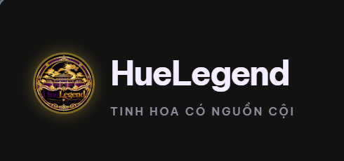

# HueLegend — Tinh hoa có nguồn cội

<p align="center">
  
</p>

**Hệ thống ứng dụng Blockchain truy xuất nguồn gốc và thương mại điện tử phân quyền cho các sản phẩm đặc sản truyền thống Cố đô Huế** (Mè xửng, tôm chua, trà cung đình, tinh dầu tràm và các sản phẩm làng nghề truyền thống).

## 👥 Thành viên thực hiện dự án

1. **Ngô Quỳnh Trang** — Mã sinh viên: `23K4300041`
2. **Ngô Thị Thuỷ Vân** — Mã sinh viên: `23K4300023`

## 🌐 Liên kết triển khai trực tuyến (Deployment Links)

- 🛍️ **HueLegend Market (Gian hàng đặc sản & 4 nhóm vai trò):** [https://huelegend-dapp.vercel.app/market.html](https://huelegend-dapp.vercel.app/market.html)
- 🔍 **HueLegend DApp (Truy xuất nguồn gốc chuỗi cung ứng):** [https://huelegend-dapp.vercel.app](https://huelegend-dapp.vercel.app)
- 📦 **Mã nguồn GitHub Repository:** [https://github.com/nqt2808/HueLegend](https://github.com/nqt2808/HueLegend)
- ⚙️ **Kiểm tra trạng thái API (Health Check):** [https://huelegend-dapp.vercel.app/api/health](https://huelegend-dapp.vercel.app/api/health)

## 🔑 Phân chia vai trò & Cơ chế xác thực quyền (Ethereum Sepolia Testnet)

| Nhóm vai trò | Cơ chế xác định quyền | Quyền hạn on-chain |
| :--- | :--- | :--- |
| 🛡️ **Quản trị (Admin)** | Ví mặc định: `0x2e4216e1BCA81d308b25adaD6ef5Ea92E2e42F8c` (Deployer/Contract Owner) | Quản lý hệ thống, duyệt hồ sơ GPKD + ATTP, duyệt lô hàng, xử lý tranh chấp Escrow |
| 🏭 **Cơ sở SX & Kiểm định** | Ví nộp hồ sơ on-chain & được Admin phê duyệt (kèm ký quỹ bảo chứng) | Nộp mã băm SHA-256 GPKD & ATTP, nộp ký quỹ bảo chứng, tạo và đăng ký lô đặc sản |
| 🏪 **Nơi bán (Retailer)** | Ví được phân phối hoặc cơ sở liên kết tiếp nhận phân phối | Tiếp nhận lô hàng, quản lý tồn kho, xác nhận vận chuyển đơn hàng |
| 🛒 **Người mua (Buyer)** | Bất kỳ ví cá nhân nào kết nối qua MetaMask | Quét mã QR minh bạch, đặt mua và giữ tiền an toàn qua Smart Contract Escrow |

> ⚠️ **LƯU Ý:** ĐÂY LÀ DỰ ÁN HỌC TẬP FULLSTACK MVP (MÔN ECO2432), CHƯA KIỂM TOÁN BẢO MẬT ĐỂ GIAO DỊCH TIỀN THẬT. Mọi giao dịch được thực hiện bằng ETH thử nghiệm trên mạng Ethereum Sepolia Testnet. Tuyệt đối không dùng tiền thật và không hiển thị dữ liệu mô phỏng như dữ liệu nguồn gốc blockchain thực tế.

## 🚀 Tính năng nổi bật của hệ thống

- **Giao diện thuần Việt sang trọng:** Thiết kế mang phong cách văn hóa Cố Đô Huế với tone màu đen than hoàng gia `#141318`, ánh vàng kim `#d4af37` và tím cung đình.
- **Truy xuất nguồn gốc on-chain:** Tra cứu, tìm kiếm danh mục lô hàng, hiển thị trang QR chi tiết, các mốc chặng kiểm định và trạng thái chứng từ bất biến.
- **Kết nối trực tiếp ví MetaMask:** Tương tác on-chain thật qua mạng Ethereum Sepolia Testnet, đã loại bỏ hoàn toàn chế độ demo mô phỏng.
- **Phân quyền 4 nhóm vai trò nghiêm ngặt:** Quản trị viên, Cơ sở sản xuất & Kiểm định, Nơi bán và Người mua có giao diện và quyền thực thi riêng biệt.
- **Xác thực pháp lý bằng SHA-256:** Cơ sở sản xuất nộp Giấy phép kinh doanh (GPKD) và Giấy chứng nhận vệ sinh an toàn thực phẩm (ATTP) dưới dạng mã băm mật mã học được quản trị viên phê duyệt on-chain.
- **Bảo chứng ký quỹ (Staking) & Escrow:** Cơ sở sản xuất phải ký quỹ cọc bảo chứng chất lượng; người mua thanh toán giữ tiền qua hợp đồng ủy thác trung gian (Escrow) trước khi xác nhận đơn hàng thành công.
- **API Serverless trên Vercel:** Xử lý đọc dữ liệu nhanh chóng, toàn bộ thao tác ghi trạng thái đều do người dùng trực tiếp ký xác thực bằng ví MetaMask cá nhân.
- **Hợp đồng thông minh phân quyền:** Tích hợp kiểm soát vai trò AccessControl, lưu vết lịch sử kiểm định và phát sự kiện (`event`) minh bạch.
- **Bộ kiểm thử tự động toàn diện:** Đạt 38/38 ca kiểm thử bảo mật, kiểm tra luồng logic và ngăn chặn các hành vi gian lận.

## 🏛️ Kiến trúc hệ thống (Architecture)

```text
Người xem công khai  --> Giao diện HTTPS (Vercel) --> Vercel API (Chỉ đọc) --> RPC Sepolia --> Smart Contracts
Cơ sở SX / Nơi bán   --> Ký giao dịch ví MetaMask ----------------------------> Mạng Sepolia --> Smart Contracts
Quản trị viên        --> Ký giao dịch ví MetaMask (Backend duyệt hồ sơ / lô) -> Mạng Sepolia --> Smart Contracts
```

**GitHub đóng vai trò lưu trữ mã nguồn. Vercel đảm nhận triển khai giao diện người dùng và Serverless API.**

## 💻 Hướng dẫn cài đặt & Khởi chạy nhanh (Quick Start)

Yêu cầu môi trường: Cài đặt **Node.js phiên bản 20 trở lên** (khuyến nghị Node 24+).

1. Tải hoặc sao chép mã nguồn về thư mục `HueLegend`:
```powershell
cd "$env:USERPROFILE\Downloads\HueLegend"
```

2. Cài đặt các gói phụ thuộc:
```powershell
npm.cmd install
```

3. Chạy kiểm thử tự động (38 kiểm thử đơn vị & tích hợp):
```powershell
npm.cmd test
```

4. Đóng gói bản dựng sản xuất:
```powershell
npm.cmd run build
```

5. Khởi chạy máy chủ nội bộ:
```powershell
npm.cmd start
```

Mở trình duyệt tại địa chỉ `http://localhost:5173`.
- Truy cập Marketplace tại: `http://localhost:5173/market.html`.
- Kiểm tra trạng thái API chỉ đọc tại: `http://localhost:5173/api/health`.

## 📜 Chặng phát triển & Cải tiến hệ thống

- **API `/api/config` & `/api/market-config`:** Cho phép giao diện đồng bộ địa chỉ hợp đồng trực tiếp từ cấu hình máy chủ Vercel mà không để lộ URL RPC nhạy cảm.
- **Bộ xử lý Web Handler cho Vercel:** Hỗ trợ chạy Serverless Functions đồng thời tương thích hoàn toàn khi chạy máy chủ local.
- **Xuất dữ liệu CSV an toàn:** Cho phép xuất danh sách lô hàng ra tệp CSV, tích hợp cơ chế phòng chống tấn công CSV Formula Injection và gắn cờ dữ liệu.
- **Lệnh kiểm tra hệ thống:** `npm run check:deployment -- https://ten-dapp.vercel.app` kiểm tra tự động các endpoint trực tuyến.
- **Tài liệu chi tiết các giai đoạn:** Tham khảo thêm tại [docs/PHASES_2_4.md](docs/PHASES_2_4.md) và [docs/MARKETPLACE.md](docs/MARKETPLACE.md).

## 🚢 Hướng dẫn triển khai (Deployment)

- **Hướng dẫn tạo kho lưu trữ GitHub:** [docs/GITHUB_AND_VERCEL.md](docs/GITHUB_AND_VERCEL.md)
- **Sổ tay vận hành Fullstack:** [docs/FULLSTACK.md](docs/FULLSTACK.md)
- **Lộ trình phát triển:** [docs/ROADMAP.md](docs/ROADMAP.md)
- **Chính sách bảo mật:** [SECURITY.md](SECURITY.md)
- **Hướng dẫn cấu hình Vercel:** [DEPLOY-VERCEL.md](DEPLOY-VERCEL.md)
- **Tài liệu giao diện tiền nhiệm:** [docs/FRONTEND_README_LEGACY.md](docs/FRONTEND_README_LEGACY.md)

Tệp cấu hình Vercel tại thư mục gốc: `vercel.json` (lệnh build: `npm run build` tạo thư mục `dist/`; serverless functions trong thư mục `api/`). Quy trình CI GitHub Actions tại `.github/workflows/ci.yml` tự động kiểm thử JavaScript khi có push hoặc pull request.

## ⚙️ Biến môi trường (Environment Variables)

Tham khảo tệp mẫu `.env.example`. Máy chủ đọc các biến môi trường sau:
- `HUELEGEND_RPC_URL`: URL RPC công khai (HTTPS) để đọc dữ liệu Sepolia.
- `HUELEGEND_CONTRACT_ADDRESS`: Địa chỉ hợp đồng thông minh `ProjectCore` đã triển khai trên Sepolia.
- `HUELEGEND_MARKET_ADDRESS`: Địa chỉ hợp đồng thông minh `HueLegendMarket` đã triển khai trên Sepolia.

> 🔒 **Lưu ý bảo mật:** Tuyệt đối không lưu khóa riêng tư (Private Key) hoặc khóa RPC trả phí trên mã nguồn client-side.

## ⚠️ Giới hạn kỹ thuật & Lưu ý vận hành

1. **Môi trường thử nghiệm:** Hợp đồng thông minh được thiết kế phục vụ đề tài học tập, cần được kiểm toán độc lập trước khi ứng dụng trong thương mại thực tế với tài sản lớn.
2. **Lưu trữ chứng từ:** Mã băm SHA-256 được lưu trữ bất biến on-chain để đối soát; tệp hình ảnh gốc của giấy tờ được lưu trữ ngoại tuyến hoặc phân tán (IPFS) để bảo vệ quyền riêng tư doanh nghiệp.
3. **Mã QR vật lý:** Mã QR liên kết trực tiếp tới giao dịch Etherscan và trang thông tin chi tiết; việc dán tem QR lên bao bì vật lý cần kết hợp giải pháp chống bóc tách giả mạo.
4. **Cơ chế rút cọc:** Cơ sở sản xuất chỉ được rút tiền ký quỹ sau khi hết thời hạn khóa quy định và không có tranh chấp vi phạm chất lượng.

## 🛡️ Các trường hợp kiểm thử an toàn tiêu biểu (Negative Checks)

1. **Chặn mạo danh tạo lô:** Ví chưa được cấp vai trò hoặc chưa nộp đủ cọc bảo chứng gọi `submitLot()` -> Giao dịch bị hoàn tác (`revert UnauthorizedCaller`).
2. **Chống trùng lặp mã lô:** Tạo lô hàng với mã lô đã tồn tại trong hợp đồng -> Giao dịch bị hoàn tác (`revert LotAlreadyExists`).
3. **Chặn duyệt trái phép:** Ví không thuộc quyền Quản trị viên (`ROLE_ADMIN`) gọi hàm `approveLot()` hoặc `registerSeller()` -> Giao dịch bị từ chối ngay lập tức.
4. **Bảo vệ tiền ký thác Escrow:** Cơ sở sản xuất hoặc bên thứ ba không thể rút tiền người mua khi đơn hàng chưa hoàn tất xác nhận nhận hàng hoặc chưa giải quyết tranh chấp.

## 📄 Bản quyền & An toàn bảo mật

- Tuyệt đối không chia sẻ cụm từ khôi phục (Seed Phrase) hoặc Private Key của ví cá nhân.
- Các thao tác đọc dữ liệu qua API không yêu cầu Private Key máy chủ.
- Xem chi tiết giấy phép tại [LICENSE](LICENSE) và danh mục tài nguyên nguồn mở tại [docs/SOURCES.md](docs/SOURCES.md).

---

## 🛍️ HueLegend Market (Phân hệ Thương mại Đặc sản Sepolia)

Trang **`/market.html`** bao gồm gian hàng đặc sản, đăng ký cơ sở có mã băm SHA-256 Giấy phép kinh doanh và Giấy chứng nhận vệ sinh an toàn thực phẩm, duyệt hồ sơ và duyệt lô hàng bởi ví Quản trị viên, niêm yết giá bán và luồng đặt hàng giữ tiền qua Smart Contract Escrow bằng ví MetaMask trên Ethereum Sepolia Testnet.

Hợp đồng phân hệ thương mại nằm tại `contracts/HueLegendMarket.sol`. Chi tiết quy trình nghiệp vụ và hướng dẫn vận hành: [docs/MARKETPLACE.md](docs/MARKETPLACE.md).
